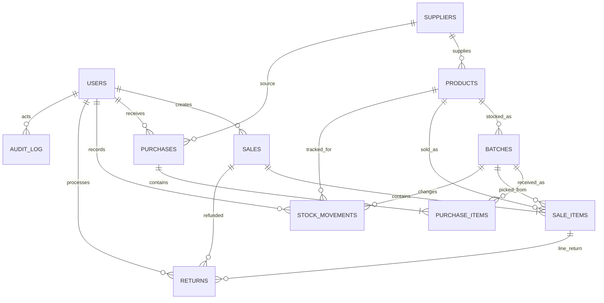

# Data model

`batches.quantity` is the current on-hand balance. Every purchase, sale, return, opening balance, or adjustment writes a signed `stock_movements.quantity_delta` with a reason and actor. Sale and adjustment paths update the balance and movement in one database transaction. A stock reconciliation compares batch balance with the sum of movements from recorded opening stock onward.
